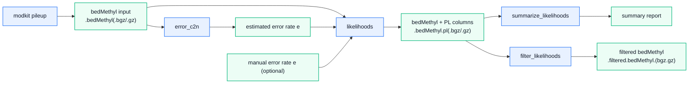

# Rust implementation of CpG-likelihoods
Single-molecule sequencing is readily adapted for the analysis of epigenetic DNA modifications such as 5-methylcytosine (5mC) and 5-hydroxymethylcytosine (5hmC). A major advantage of Oxford Nanopore (Nanopore) and Pacific Biosciences (PacBio) sequencing platforms is their ability to capture both the primary DNA sequence and epigenetic modifications simultaneously. This enables the analysis of sample-specific CpG loci not represented in the reference genome, which typically account for approximately 50% of heterozygous CpG loci in a sample, as well as a variable number of homozygous CpG loci depending on the evolutionary distance between the sample and the reference genome. These sample-specific loci are important for accurate modification analyses, and this project provides a likelihood-based workflow for identifying both reference and non-reference CpG loci directly from a bedmethyl file.



## Table of contents

- [Installation](#installation)
- [Quickstart](#quickstart)
- [Detailed usage](#detailed-usage)
  - [Estimate error rate](#estimate-error-rate)
    - [Example](#example-1)
  - [Calculate likelihoods](#calculate-likelihoods)
    - [Example](#example-2)
  - [Summarize and filter likelihoods](#summarize-and-filter-likelihoods)
    - [Example](#example-3)
    - [Example](#example-4)
- [Notes](#notes)

## Installation

### Prebuilt executables

Download the executable for your platform from
[GitHub Releases](https://github.com/SrenBlikdal/cpg_likelihoods/releases).
Binaries are available for Windows (x86-64), Linux (x86-64), and macOS (Intel and
Apple Silicon). Linux builds require glibc from Ubuntu 22.04 or newer.

Rename the downloaded file to `cpg-likelihoods` (`cpg-likelihoods.exe` on Windows)
and place it on your PATH. On Linux/macOS, give it executable permission:

```sh
chmod +x cpg-likelihoods
```

### cargo-binstall

With [cargo-binstall](https://github.com/cargo-bins/cargo-binstall) installed:

```sh
cargo binstall --git https://github.com/SrenBlikdal/cpg_likelihoods cpg_likelihoods
cpg-likelihoods --help
```

### Build from source

This project is written in Rust and uses Cargo for building and running the tools.

1. Install the Rust toolchain if it is not already installed:

```bash
curl https://sh.rustup.rs -sSf | sh
source $HOME/.cargo/env
```

2. Clone the repository and build the project:

```bash
git clone https://github.com/SrenBlikdal/cpg_likelihoods.git
cd cpg_likelihoods
cargo build --release
```

3. The compiled binary is `target/release/cpg-likelihoods` (`cpg-likelihoods.exe` on Windows):

```bash
ls target/release/
```

You can then run the subcommands directly, for example:

```bash
./target/release/cpg-likelihoods error_c2n input.bedMethyl
```

or use Cargo to run them from the project root:

```bash
cargo run -r -- error_c2n input.bedMethyl
```

Install the executable on your PATH with `cargo install --path . --locked`.

## Quickstart

```bash
#Estimate the CpG-to-non-CpG error rate: 
cargo run -r -- error_c2n input.bedMethyl

#Calculate likelihoods and append PL columns to the bedMethyl file: 
cargo run -r -- likelihoods input.bedMethyl --out output.bedMethyl

#Summarize the CpG states in the bedMethyl  
cargo run -r -- summarize_likelihoods output.bedMethyl --min-gq 20

#Filter for homozygous/heterozygous CpG loci and remove PL columns:
cargo run -r -- filter_likelihoods --input-bed output.bedMethyl --output-bed filtered.bedMethyl --state CpG_hom/het --min-gq 20
```

## Detailed usage 

Input uses exactly the 18-column modkit bedMethyl schema. Annotated input to
summary/filter has exactly 21 columns, with `PL_hom_cpg`, `PL_het_cpg`, and
`PL_non_cpg` appended in that order. Reannotation and extra columns are rejected.
Column headers are updated when PL columns are added or removed; other metadata
is preserved. Both tab-only and mixed
tab/space delimiters are accepted; generated data rows use tabs. Blank lines,
`#` comments, BED `track`/`browser` directives, and recognized column headers
are treated as metadata. Malformed data stops processing with the input path,
line number, and a field or column-count error. Failed processing preserves any
previous output, and input/output paths referring to the same file are rejected.
Input compression is detected from the contents; output uses gzip for `.gz`,
BGZF for `.bgz`/`.bgzf`, and plain text for other extensions.

The workflow consists of four subcommands. Run `cpg-likelihoods --help` or
`cpg-likelihoods <subcommand> --help` for usage.

### Estimate error rate
This step estimates the combined error rate for sequencing and mapping errors at CpG loci. The input is a `bedMethyl` file containing read-based pileup information for all candidate CpG sites. 

For each locus, the pileup has recorded genotypic information as:

- The number of mapped CpG-sites (C<sub>i</sub>) : N<sub>valid_cov</sub>
- The number of mapped non-CpGs (D<sub>i</sub>) :
  - Number of deletions : N<sub>delete</sub> 
  - Number of DN : N<sub>diff</sub>
  - Number of CH : N<sub>nocall</sub> 

The function first identifies a subset of loci that are likely to represent homozygous CpG sites. By default the loci are retained if: 

$$
10 \leq C_i \leq 100 \qquad \text{and} \qquad \frac{C_i}{C_i + D_i} \geq 0.8,
$$

The corresponding thresholds can be adjusted using the command-line parameters `--min-cov`, `--max-cov`, and `--min-ratio`.

Assuming these loci are true homozygous CpG sites, the global CpG-to-non-CpG miscall rate is estimated as:

$$
\hat{\varepsilon} = \frac{\sum_{i} D_i} {\sum_{i} (C_i + D_i)}.
$$

This estimate is treated as the sample-wide CpG error rate and is used in subsequent likelihood calculations. The approach assumes that sequencing and mapping errors are approximately symmetric across CpG and non-CpG states throughout the genome.

#### Example 1

| chrom | start | end | ... | N<sub>valid_cov | N<sub>delete | N<sub>diff | N<sub>nocall | Retained |
| --- | --- | --- | --- | --- | --- | --- | --- | --- |
| chr1 | 1000 | 1001 | ... | 30 | 0 | 0 | 2 | ✓ |
| chr1 | 1001 | 1002 | ... | 28 | 0 | 0 | 0 | ✓ |
| chr1 | 1011 | 1012 | ... | 15 | 0 | 15 | 1 | ✗ (`min-ratio`) |
| chr1 | 1012 | 1013 | ... | 13 | 0 | 15 | 1 | ✗ (`min-ratio`) |
| chr1 | 1021 | 1022 | ... | 1 | 0 | 28 | 1 | ✗ (`min-cov`,`min-ratio`) |
| chr1 | 1033 | 1034 | ... | 30 | 6 | 1 | 1 | ✗ (`min-ratio`) |

$$
\hat{\varepsilon} = \frac{2} {(58+2)} = 0.03333
$$

### Calculate likelihoods
This step models the likelihood of observing the read data given an underlying CpG state. Under the assumption that all loci are biallelic and diploid the three possible CpG states (z) are:

- Homozygues CpG (CpG<sub>hom</sub>): Both alleles at the locus are CpG
- Heterozygues CpG (CpG<sub>het</sub>): One allele at the locus is CpG, the other in non-CpG - non-CpG (nonCpG<sub>het</sub>): Neither alleles at the locus are CpGs

The likelihood of the data given the genotype and error is modeled assuming reads and errors are independent. Specifically the likelihoods for the different CpG states at each locus are computed as: 

$$
L({\mathrm{CpG_hom}})=
(1-\hat{\varepsilon})^{\ C_i} \ 
\hat{\varepsilon}\ ^{D_i}
$$

$$
L({\mathrm{CpG_het}})=
0.5^{\ C_i+D_i}
$$

$$
L({\mathrm{non-CpG}})=
\hat{\varepsilon}^{\ C_i} \ 
(1-\hat{\varepsilon})^{\ D_i}
$$

The optional `--n` parameter is a common likelihood scale factor.
It adds `(C_i + D_i) * log10(n)` to all three reported log-likelihoods and
therefore cancels from normalized probabilities and PLs. It must be finite and
positive. Error rates must be finite and between zero and one (inclusive).
Zero-coverage sites have equal likelihoods and remain unclassified. Normalized
probabilities use equal genotype priors; they are not calibrated posterior
confidence estimates.

These values are transformed to raw Phred-scaled likelihoods for the CpG state L(z|Data) by -10*log(L(z|Data)) and normalized such that the lowest PL for each locus is 0 and the rest are scaled relative to that. 

#### Example 2

The first locus in the example above (`chr1:1000-1001`) had 30 read supporting CpG and 2 reads supporting non-CpG and a estimated error rate of 0.03333:

$$
C_i = 30
\qquad
D_i = 2
\qquad
\hat{\varepsilon} = 0.03333
$$

The raw likelihoods are:

$$
L(\mathrm{CpG_{hom}})=
(1-0.03333)^{30}
\times
0.03333^{2} =
4.02 \times 10^{-4}
$$

$$
L(\mathrm{CpG_{het}})=
0.5^{30+2} =
2.33 \times 10^{-10}
$$

$$
L(\mathrm{nonCpG})=
0.03333^{30}
\times
(1-0.03333)^{2} = 
4.52 \times 10^{-45}
$$

The raw Phred-scaled likelihoods are:

$$
PL(\mathrm{CpG_{hom}})=
-10\log_{10}(4.02 \times 10^{-4})=
33.96
$$

$$
PL(\mathrm{CpG_{het}})=
-10\log_{10}(2.33 \times 10^{-10})=
96.33
$$

$$
PL(\mathrm{nonCpG})=
-10\log_{10}(4.52 \times 10^{-45})=
443.44
$$

The normalized PL where the minimum PL is then subtracted from all values are:

$$
PL(\mathrm{CpG_{hom}})=0
$$
$$
PL(\mathrm{CpG_{het}})=62
$$
$$
PL(\mathrm{nonCpG})=409
$$

Indicating strong support for a homozygous CpG at (`chr1:1000-1001`). 

The example table with normalized PL added:

| chrom | start | end | ... | N_valid_cov | N_delete | N_diff | N_nocall | PL(CpG_hom) | PL(CpG_het) | PL(non-CpG) |
| --- | --- | --- | --- | --- | --- | --- | --- | --- | --- | --- |
| chr1 | 1000 | 1001 | ... | 30 | 0 | 0 | 2 | 0 | 62 | 409 |
| chr1 | 1001 | 1002 | ... | 28 | 0 | 0 | 0 | 0 | 80 | 409 |
| chr1 | 1011 | 1012 | ... | 15 | 0 | 15 | 1 | 145 | 0 | 131 |
| chr1 | 1012 | 1013 | ... | 13 | 0 | 15 | 1 | 151 | 0 | 107 |
| chr1 | 1021 | 1022 | ... | 1 | 0 | 28 | 1 | 409 | 71 | 0 |
| chr1 | 1033 | 1034 | ... | 30 | 6 | 1 | 1 | 8 | 0 | 330 |

### Summarize and filter likelihoods
This step summarizes and filter across the inferred CpG states in a `bedMethyl` file after likelihood calculations.

For each locus, the function: 
1. Identifies the most likely CpG state based on the normalized PL values.
2. Identifies the second most likely CpG state.
3. Calculates a quality score (GQ) for the CpG state as the difference between the lowest (0) and second-lowest PL value.

It is often hard to distinguish homozygous and heterozygous CpGs leading to a high number of unclassified loci with CpG<sub>hom</sub> and CpG<sub>het</sub> as the two most likely CpG states, but low QC. To keep these loci for downstream analysis CpG<sub>hom</sub> and CpG<sub>het</sub> can be collapsed to combined CpG state (CpG<sub>hom/het</sub>) with the corresponding GQ describing the certainty that the locus is not a non-CpG. This setting classifies more loci than CpG<sub>hom</sub> and CpG<sub>het</sub>.  

#### Example 3

| chrom | start | end | ... | N_valid_cov | N_delete | N_diff | N_nocall | PL(CpG_hom) | PL(CpG_het) | PL(non-CpG) | state | GQ
| --- | --- | --- | --- | --- | --- | --- | --- | --- | --- | --- | --- | --- |
| chr1 | 1000 | 1001 | ... | 30 | 0 | 0 | 2 | 0 | 62 | 409 | CpG_hom | 62 |
| chr1 | 1001 | 1002 | ... | 28 | 0 | 0 | 0 | 0 | 80 | 409 | CpG_hom | 80 |
| chr1 | 1011 | 1012 | ... | 15 | 0 | 15 | 1 | 145 | 0 | 131 | CpG_het | 131 |
| chr1 | 1012 | 1013 | ... | 13 | 0 | 15 | 1 | 151 | 0 | 107 | CpG_het | 107 |
| chr1 | 1021 | 1022 | ... | 1 | 0 | 28 | 1 | 409 | 71 | 0 | non-CpG | 71 |
| chr1 | 1033 | 1034 | ... | 30 | 6 | 1 | 1 | 8 | 0 | 330 | CpG_het | 8 |

Given a minimum GQ threshold the summary reports: 
- Total number of loci in the bedMethyl file.
Classification with separate homozygous and heterozygous CpG states:
- Number and percent of loci classified as CpG_hom.
- Number and percent of loci classified as CpG_het.
- Number and percent of loci classified as non-CpG.
- Number and percent of unclassified loci.   
Classification with collapsed homozygous and heterozygous CpG states:
- Number and percent of loci classified as CpG_hom/het.
- Number and percent of loci classified as non-CpG.
- Number and percent of unclassified loci. 

To filter a bedMethyl file after likelihood calculations we can use the filter likelihood function which follow the same logic as the summary function

#### Example 4

cpg-likelihoods filter_likelihoods --input-bed output.bedMethyl --output-bed filtered.bedMethyl --state CpG_hom/het --min-gq 20

| chrom | start | end | ... | N_valid_cov | N_delete | N_diff | N_nocall
| --- | --- | --- | --- | --- | --- | --- | --- |
| chr1 | 1000 | 1001 | ... | 30 | 0 | 0 | 2 |
| chr1 | 1001 | 1002 | ... | 28 | 0 | 0 | 0 |
| chr1 | 1011 | 1012 | ... | 15 | 0 | 15 | 1 |
| chr1 | 1012 | 1013 | ... | 13 | 0 | 15 | 1 |
| chr1 | 1033 | 1034 | ... | 30 | 6 | 1 | 1 |

The PL columns can be retained using --keep-pl

## Notes

### Input interpretation and biological validation

Use cytosine-modification pileups for this CpG model. Each bedMethyl data row is
an independent record: the tool does not combine modification codes, strands,
motifs, or repeated coordinates. The summary's **Total loci** is therefore a row
count, not a count of unique genomic positions. Multiple modification-code rows
can describe the same underlying observations. Record the modkit/basecaller
versions and the exact commands used to generate your input, including any
`--combine-mods`, `--combine-strands`, and motif filters.

Modkit's `--cpg` option restricts output to reference CpGs. A dataset generated
with that restriction cannot test discovery of non-reference CpGs excluded
before this tool runs. Candidate-site generation for non-reference discovery
needs a separately documented and validated procedure. See the
[modkit pileup documentation](https://software-docs.nanoporetech.com/modkit/intro_pileup.html).

This model uses column 5 (modkit's score, equal to valid coverage) as CpG support
and columns 15 + 17 + 18 as non-CpG support. It treats deletions, different bases,
and missing modification calls as evidence against CpG. A missing modification
call is not itself proof of a non-CpG sequence: modkit defines it as an aligned
canonical base without a modification call. Whether that proxy is appropriate
depends on the basecalling model and input preparation. The likelihood model
also assumes diploid genotypes, independent observations, and symmetric errors.
Validate those assumptions with known genotypes before interpreting PL/GQ as
evidence of biological accuracy. Software regression tests do not establish
these assumptions.

The modkit repository's
[lung chr20 fixture](https://github.com/nanoporetech/modkit/blob/master/tests/resources/lung_00733-m_adjacent-normal_5mc-5hmc_chr20_cpg_pileup.bed.gz)
is useful for testing gzip input and mixed delimiters. It is not a genotype truth
set. The small fixtures in `tests/` are synthetic, allowing regression tests to
run without downloading external data.

Development alpha version - comes without any guaranty and with room for improvement.  


