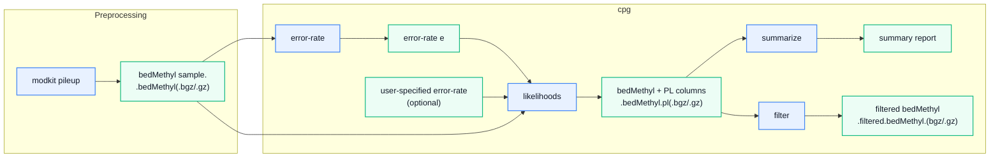

# CpG: Likelihood-Based Calling of CpG States from bedMethyl Data
Single-molecule sequencing is readily adapted for analyzing epigenetic modifications. A major advantage of Oxford Nanopore and Pacific Biosciences (PacBio) platforms is their ability to capture both the primary DNA sequence and epigenetic modification states in the same read, enabling direct analysis of CpG loci from read-level pileup data.

This project implements a likelihood-based workflow for calling CpG states from modkit `bedMethyl` files. The workflow estimates a sample-specific CpG-to-non-CpG error rate, calculates likelihoods for three possible CpG states: Homozygous (`CpG_hom`), heterozygous (`CpG_het`), and non-CpG (`non-CpG`), and summarizes or filters calls using a minimum genotype-quality threshold (min-gq).

A key feature is the ability to analyze epigenetic modifications at both reference and non-reference CpG loci directly from a `bedMethyl` file. While non-reference CpGs are not represented in the haploid reference genome, they may still carry biologically important epigenetic information in the sample that would be missed by reference-guided approaches.

## Workflow
The workflow takes a modkit `bedMethyl` file as input and produces likelihood-annotated, summarized, or filtered CpG calls.

```bash
# Estimate CpG-to-non-CpG error-rate from bedmethyl
cpg error-rate sample.bedMethyl

# Calculate likelihoods and append to the bedmethyl file
cpg likelihoods sample.bedMethyl --out sample.pl.bedMethyl

# Summarize CpG states
cpg summarize sample.pl.bedMethyl --min-gq 20

# Filter loci and remove PL columns
cpg filter sample.pl.bedMethyl \
  --out sample.filtered.bedMethyl \
  --state CpG_hom/het \
  --min-gq 20
```



## Input and outputs

**input.bedMethyl** - read-level methylation pileup generated by `modkit pileup`. This is the primary input to the workflow.

**output.bedMethyl** - likelihood-annotated `bedMethyl` file containing additional PL (phred-scaled likelihood) columns for the three possible CpG states. This file serves as input to `summarize` and `filter`.

**filtered.bedMethyl** - The subset of loci passing the specified CpG state (`CpG_hom`, `CpG_het`, `CpG_hom/het`, `non-CpG`) and genotype-quality (`min-gq`) filters. PL columns are removed, producing a standard `bedMethyl` file for downstream analyses.

## Table of contents

- [Installation](#installation)
- [Quick start](#quick-start)
- [Command reference](#command-reference)
  - [error-rate](#estimate-error-rate)
  - [likelihoods](#calculate-likelihoods)
  - [summarize](#summarize)
  - [filter](#filter)
- [Notes](#notes)

## Installation

### Prebuilt executables (recommended)

Download the executable for your platform from
[GitHub Releases](https://github.com/SrenBlikdal/cpg_likelihoods/releases).
Binaries are available for Windows, Linux, and macOS.

Rename the downloaded file to `cpg-likelihoods` (`cpg-likelihoods.exe` on Windows)
and place it on your PATH. On Linux/macOS, give it executable permission:

```sh
chmod +x cpg-likelihoods
```

### cargo-binstall

With [cargo-binstall](https://github.com/cargo-bins/cargo-binstall) installed:

```sh
cargo binstall --git https://github.com/SrenBlikdal/cpg_likelihoods cpg_likelihoods
cpg-likelihoods --help
```

### Build from source

This project is written in Rust and uses Cargo for building and running the tools.

1. Install the Rust toolchain if it is not already installed:

```bash
curl https://sh.rustup.rs -sSf | sh
source $HOME/.cargo/env
```

2. Clone the repository and build the project:

```bash
git clone https://github.com/SrenBlikdal/cpg_likelihoods.git
cd cpg_likelihoods
cargo build --release
```

3. The compiled binary is `target/release/cpg-likelihoods` (`cpg-likelihoods.exe` on Windows):

```bash
ls target/release/
```

You can then run the subcommands directly, for example:

```bash
./target/release/cpg-likelihoods error-rate sample.bedMethyl
```

or use Cargo to run them from the project root:

```bash
cargo run -r -- error-rate sample.bedMethyl
```

Install the executable on your PATH with `cargo install --path . --locked`.

## Quick start

### 1. Generate a bedMethyl file with modkit
CpG use a bedMethyl pileup file from modkit as input.
To retain non-reference CpG loci, generate the pileup without specifying --cpg and without providing a reference genome.

```bash
modkit pileup path/to/sample.bam output/path/sample.bedMethyl \
  --modified-bases 5mC 5hmC
```

### 2. Estimate the error rate (optional)
Estimate a sample-specific CpG-to-non-CpG error rate.

```bash
cpg error-rate sample.bedMethyl
```

### 3. Calculate likelihoods
Append phred-scaled likelihood (PL) values for the three possible CpG states.

```bash
cpg likelihoods sample.bedMethyl --out sample.pl.bed
```

### 4. Summarize CpG states
Generate summary statistics for CpG states in the likelihood-annotated file.

```bash
cpg summarize sample.pl.bedMethyl--min-gq 20
```

### 5. Filter loci
Retain loci matching the requested CpG state and minimum genotype quality.

```bash
cpg filter sample.pl.bedMethyl
  --out filtered.bedMethyl \
  --state CpG_hom/het \
  --min-gq 20
```

## Command reference

### error-rate
Estimate a sample-specific CpG-to-non-CpG error rate from a `bedMethyl` file. The input is a `bedMethyl` file containing read-based pileup information for candidate CpG loci.

For each locus, the workflow uses the following pileup counts reported by modkit:

- CpG observations (C<sub>i</sub>) : N<sub>valid_cov</sub>
- Non-CpG observations (D<sub>i</sub>) :
  - Deletions: N<sub>delete</sub> 
  - DN observations: N<sub>diff</sub>
  - CH observations: N<sub>nocall</sub> 

The function first identifies a subset of loci likely to represent homozygous CpGs. By default, loci are retained if: 

$$
10 \leq C_i \leq 100 \qquad \text{and} \qquad \frac{C_i}{C_i + D_i} \geq 0.8,
$$

The corresponding thresholds can be adjusted using the command-line parameters `--min-cov`, `--max-cov`, and `--min-ratio`.

Assuming these loci are true homozygous CpG sites, the global CpG-to-non-CpG miscall rate is estimated as:

$$
\hat{\varepsilon} = \frac{\sum_{i} D_i} {\sum_{i} (C_i + D_i)}.
$$

This estimate is treated as the sample-wide CpG error rate and is used in subsequent likelihood calculations. The method assumes that sequencing and mapping errors are approximately symmetric between CpG and non-CpG states across the genome.

#### Example: estimating the error rate

```bash
cpg error-rate sample.bed
```

| chrom | start | end | ... | N<sub>valid_cov | N<sub>delete | N<sub>diff | N<sub>nocall | Retained |
| --- | --- | --- | --- | --- | --- | --- | --- | --- |
| chr1 | 1000 | 1001 | ... | 30 | 0 | 0 | 2 | ✓ |
| chr1 | 1001 | 1002 | ... | 28 | 0 | 0 | 0 | ✓ |
| chr1 | 1011 | 1012 | ... | 15 | 0 | 15 | 1 | ✗ (`min-ratio`) |
| chr1 | 1012 | 1013 | ... | 13 | 0 | 15 | 1 | ✗ (`min-ratio`) |
| chr1 | 1021 | 1022 | ... | 1 | 0 | 28 | 1 | ✗ (`min-cov`, `min-ratio`) |
| chr1 | 1033 | 1034 | ... | 30 | 6 | 1 | 1 | ✗ (`min-ratio`) |

Only the first two loci satisfy the filtering criteria and are therefore used to estimate the error rate:

$$
\hat{\varepsilon} = \frac{2} {(58+2)} = 0.03333
$$

### likelihoods
Calculate the likelihood of observing the read data under each of the three possible CpG states for all loci in a `bedMethyl` file. Assuming all loci are biallelic and diploid, the three possible CpG states (z) are:

- Homozygous CpG (`CpG_hom`): Both alleles at the locus are CpG
- Heterozygues CpG (`CpG_het`): One allele at the locus is CpG, the other in non-CpG. 
- non-CpG (non-CpG): Neither allele at the locus is CpGs

The likelihood of the observed data given the underlying CpG state and error rate is modeled assuming reads and errors are independent. Specifically, the likelihood for each CpG state at a locus is calculated as:

$$
L({\mathrm{CpG_hom}})=
(1-\hat{\varepsilon})^{\ C_i} \ 
\hat{\varepsilon}\ ^{D_i}
$$

$$
L({\mathrm{CpG_het}})=
0.5^{\ C_i+D_i}
$$

$$
L({\mathrm{non-CpG}})=
\hat{\varepsilon}^{\ C_i} \ 
(1-\hat{\varepsilon})^{\ D_i}
$$

The optional `--n` parameter is a common likelihood scale factor.
It adds `(C_i + D_i) * log10(n)` to all three reported log-likelihoods and
therefore cancels from normalized probabilities and PLs. It must be finite and
positive. Error rates must be finite and between zero and one (inclusive).
Zero-coverage sites have equal likelihoods and remain unclassified. Normalized
probabilities use equal genotype priors; they are not calibrated posterior
confidence estimates.

These likelihoods are transformed to raw Phred-scaled likelihoods (PL) as:

PL(z) = -10 \log_{10}\!\left(L(z \mid \mathrm{Data})\right)

The PL values are then normalized such that the lowest PL at each locus is set to 0 and the other PL values are expressed relative to that minimum.

#### Example : Calculating likelihoods

The first locus in the example above (chr1:1000-1001) has 30 CpG observations, 2 non-CpG observations, and an estimated error rate of 0.03333:

$$
C_i = 30
\qquad
D_i = 2
\qquad
\hat{\varepsilon} = 0.03333
$$

The raw likelihoods are:

$$
L(\mathrm{CpG_{hom}})=
(1-0.03333)^{30}
\times
0.03333^{2} =
4.02 \times 10^{-4}
$$

$$
L(\mathrm{CpG_{het}})=
0.5^{30+2} =
2.33 \times 10^{-10}
$$

$$
L(\mathrm{nonCpG})=
0.03333^{30}
\times
(1-0.03333)^{2} = 
4.52 \times 10^{-45}
$$

Likelihoods are converted to Phred-scaled likelihoods (PL), where lower values indicate greater support for a CpG state.

$$
PL(\mathrm{CpG_{hom}})=
-10\log_{10}(4.02 \times 10^{-4})=
33.96
$$

$$
PL(\mathrm{CpG_{het}})=
-10\log_{10}(2.33 \times 10^{-10})=
96.33
$$

$$
PL(\mathrm{nonCpG})=
-10\log_{10}(4.52 \times 10^{-45})=
443.44
$$

PL values are normalized by subtracting the smallest PL from all three values, such that the most likely CpG state(s) has PL = 0:

$$
PL(\mathrm{CpG_{hom}})=0
$$
$$
PL(\mathrm{CpG_{het}})=62
$$
$$
PL(\mathrm{nonCpG})=409
$$

After normalization, `CpG_hom` is the best-supported state (PL = 0). Relative to the second-best state (`CpG_het`, PL = 62), the observed data are approximately 1.6 million times more likely under a homozygous CpG model. This provides very strong support for classifying `chr1:1000-1001` as `CpG_hom`.

The normalized PL values for all example loci are shown below:

```bash
cpg likelihoods sample.bedMethyl --out sample.pl.bedMethyl
```

| chrom | start | end | ... | N_valid_cov | N_delete | N_diff | N_nocall | PL(CpG_hom) | PL(CpG_het) | PL(non-CpG) |
| --- | --- | --- | --- | --- | --- | --- | --- | --- | --- | --- |
| chr1 | 1000 | 1001 | ... | 30 | 0 | 0 | 2 | 0 | 62 | 409 |
| chr1 | 1001 | 1002 | ... | 28 | 0 | 0 | 0 | 0 | 80 | 409 |
| chr1 | 1011 | 1012 | ... | 15 | 0 | 15 | 1 | 145 | 0 | 131 |
| chr1 | 1012 | 1013 | ... | 13 | 0 | 15 | 1 | 151 | 0 | 107 |
| chr1 | 1021 | 1022 | ... | 1 | 0 | 28 | 1 | 409 | 71 | 0 |
| chr1 | 1033 | 1034 | ... | 30 | 6 | 1 | 1 | 8 | 0 | 330 |

In this example, loci 1 and 2 are strongly supported as CpG_hom, loci 3 and 4 as CpG_het, and locus 5 as non-CpG. Locus 6 is also most likely a CpG_het, but the small difference between the best and second-best PL values indicates substantially lower confidence in that classification.

### summarize
Summarize CpG states in a likelihood-annotated `bedMethyl` file.

For each locus, the function: 
1. Identifies the most likely CpG state based on normalized PL values.
2. Identifies the second most likely CpG state.
3. Calculates a quality score (GQ) for the CpG state as the difference between the lowest (0) and second-lowest PL value.

It can be difficult to distinguish homozygous and heterozygous CpGs, leading to a high number of loci where `CpG_hom` and `CpG_het` are the two most likely states, but the GQ is below the specified threshold. To retain these loci for downstream analyses, `CpG_hom` and `CpG_het` can be collapsed into a combined CpG state (`CpG_hom/het`). In this case, the corresponding GQ describes the confidence that the locus is a CpG rather than a non-CpG. This approach classifies more loci than treating `CpG_hom` and `CpG_het` as separate states.

#### Example: Summarizing likelihoods 
```bash
cpg summarize sample.pl.bedMethyl --min-gq 20
```

| chrom | start | end | ... | N_valid_cov | N_delete | N_diff | N_nocall | PL(CpG_hom) | PL(CpG_het) | PL(non-CpG) | state | GQ
| --- | --- | --- | --- | --- | --- | --- | --- | --- | --- | --- | --- | --- |
| chr1 | 1000 | 1001 | ... | 30 | 0 | 0 | 2 | 0 | 62 | 409 | CpG_hom | 62 |
| chr1 | 1001 | 1002 | ... | 28 | 0 | 0 | 0 | 0 | 80 | 409 | CpG_hom | 80 |
| chr1 | 1011 | 1012 | ... | 15 | 0 | 15 | 1 | 145 | 0 | 131 | CpG_het | 131 |
| chr1 | 1012 | 1013 | ... | 13 | 0 | 15 | 1 | 151 | 0 | 107 | CpG_het | 107 |
| chr1 | 1021 | 1022 | ... | 1 | 0 | 28 | 1 | 409 | 71 | 0 | non-CpG | 71 |
| chr1 | 1033 | 1034 | ... | 30 | 6 | 1 | 1 | 8 | 0 | 330 | CpG_het | 8 |

```text
min_GQ: 20
Total loci: 6

Classification with separate CpG states

CpG_hom        2   33.3%
CpG_het        2   33.3%
non-CpG        1   16.7%
unclassified   1   16.7%

Classification with collapsed CpG states

CpG_hom/het    5   83.3%
non-CpG        1   16.7%
unclassified   0    0.0%
```

### filter 

Filter loci in a likelihood-annotated `bedMethyl` file based on CpG state and genotype quality.

The filtering logic is identical to that used by `summarize`. A locus is retained only if:
1. Its inferred CpG state matches the requested `--state`.
2. Its genotype quality (GQ) is greater than or equal to the specified `--min-gq` threshold.

When filtering on the collapsed CpG state (`CpG_hom/het`), loci classified as either `CpG_hom` or `CpG_het` are retained provided they satisfy the minimum GQ requirement.

By default, PL columns are removed from the output, producing a standard `bedMethyl` file suitable for downstream analyses.

#### Example: Filtering loci

```bash
cpg filter sample.pl.bed
  --out filtered.bedMethyl \
  --state CpG_hom/het \
  --min-gq 20
```

Using the example above with --state CpG_hom/het and --min-gq 20, loci 1-5 satisfy the filtering criteria and are retained in filtered.bedMethyl:

| chrom | start | end | ... | N_valid_cov | N_delete | N_diff | N_nocall
| --- | --- | --- | --- | --- | --- | --- | --- |
| chr1 | 1000 | 1001 | ... | 30 | 0 | 0 | 2 |
| chr1 | 1001 | 1002 | ... | 28 | 0 | 0 | 0 |
| chr1 | 1011 | 1012 | ... | 15 | 0 | 15 | 1 |
| chr1 | 1012 | 1013 | ... | 13 | 0 | 15 | 1 |
| chr1 | 1033 | 1034 | ... | 30 | 6 | 1 | 1 |

## Notes

### Biological assumptions

Diploid sample.. 
De novo mutations.. 

### Input 

Input uses exactly the 18-column modkit bedMethyl schema. Annotated input to
summary/filter has exactly 21 columns, with `PL_hom_cpg`, `PL_het_cpg`, and
`PL_non_cpg` appended in that order. Reannotation and extra columns are rejected.
Column headers are updated when PL columns are added or removed; other metadata
is preserved. Both tab-only and mixed
tab/space delimiters are accepted; generated data rows use tabs. Blank lines,
`#` comments, BED `track`/`browser` directives, and recognized column headers
are treated as metadata. Malformed data stops processing with the input path,
line number, and a field or column-count error. Failed processing preserves any
previous output, and input/output paths referring to the same file are rejected.
Input compression is detected from the contents; output uses gzip for `.gz`,
BGZF for `.bgz`/`.bgzf`, and plain text for other extensions.

The workflow consists of four subcommands. Run `cpg-likelihoods --help` or
`cpg-likelihoods <subcommand> --help` for usage.

### Input interpretation and biological validation

Use cytosine-modification pileups for this CpG model. Each bedMethyl data row is
an independent record: the tool does not combine modification codes, strands,
motifs, or repeated coordinates. The summary's **Total loci** is therefore a row
count, not a count of unique genomic positions. Multiple modification-code rows
can describe the same underlying observations. Record the modkit/basecaller
versions and the exact commands used to generate your input, including any
`--combine-mods`, `--combine-strands`, and motif filters.

Modkit's `--cpg` option restricts output to reference CpGs. A dataset generated
with that restriction cannot test discovery of non-reference CpGs excluded
before this tool runs. Candidate-site generation for non-reference discovery
needs a separately documented and validated procedure. See the
[modkit pileup documentation](https://software-docs.nanoporetech.com/modkit/intro_pileup.html).

This model uses column 5 (modkit's score, equal to valid coverage) as CpG support
and columns 15 + 17 + 18 as non-CpG support. It treats deletions, different bases,
and missing modification calls as evidence against CpG. A missing modification
call is not itself proof of a non-CpG sequence: modkit defines it as an aligned
canonical base without a modification call. Whether that proxy is appropriate
depends on the basecalling model and input preparation. The likelihood model
also assumes diploid genotypes, independent observations, and symmetric errors.
Validate those assumptions with known genotypes before interpreting PL/GQ as
evidence of biological accuracy. Software regression tests do not establish
these assumptions.

The modkit repository's
[lung chr20 fixture](https://github.com/nanoporetech/modkit/blob/master/tests/resources/lung_00733-m_adjacent-normal_5mc-5hmc_chr20_cpg_pileup.bed.gz)
is useful for testing gzip input and mixed delimiters. It is not a genotype truth
set. The small fixtures in `tests/` are synthetic, allowing regression tests to
run without downloading external data.

Development alpha version - comes without any guaranty and with room for improvement.  


